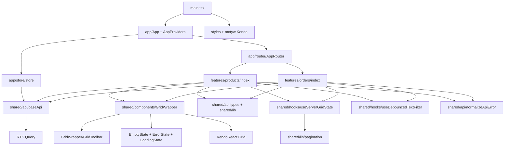
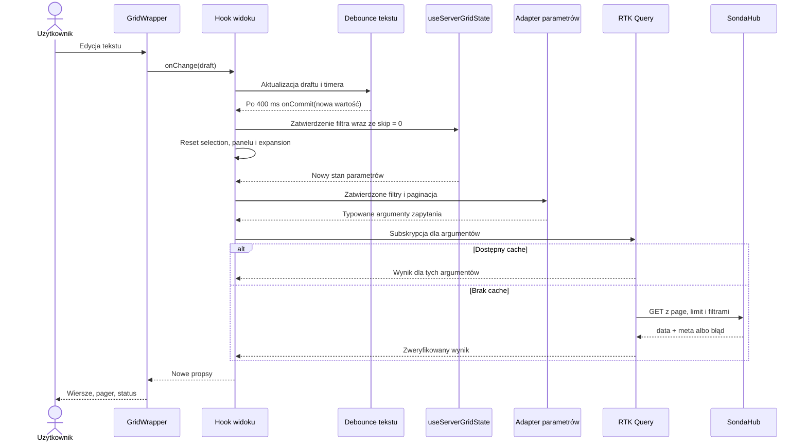

# Architektura aplikacji KDPW

Rewizja architektury po etapie 1. Data weryfikacji dokumentacji: 8 października 2026.

Aktualizacja statusu po etapie 2 (9 października 2026): przygotowano fundament
Vite/React, store z pustym baseApi, routing, style i narzędzia jakości.
Poniższy dokument zachowuje projekt docelowy oraz historyczny zakres rewizji 1.1;
nie oznacza wdrożenia wszystkich opisanych modułów. Zrealizowany podzbiór,
wersje, poprawkę deklaracji RTK i ograniczenia opisuje [README](../README.md).

Dokument rozwija wymagania z `AGENTS.md`. Zawiera projekt i kontrakty, nie
implementację. Przed rewizją projekt zawierał `AGENTS.md` i ten dokument,
bez kodu aplikacji, zależności, konfiguracji testów i katalogu `.git`.
Rewizja zachowuje generyczny grid, warstwy i kontrakty z etapu 1, a doprecyzowuje
wspólny stan, debounce, routing, toolbar i granice modułów. Wszystkie ścieżki
implementacyjne poniżej są planowane; fizycznie zmieniamy tylko ten dokument.

## 1. Opis architektury

Aplikacja React 19 + TypeScript strict, budowana przez Vite, udostępnia widoki
Products i Orders. Każdy widok konfiguruje ten sam `GridWrapper<T>` oparty na
KendoReact Grid. Redux Toolkit integruje RTK Query; dodatkowe slices nie są
potrzebne. Style komponentów są w CSS Modules. React Router obsługuje proste
trasy Products i Orders. Wspólny `useServerGridState<F>` zarządza wyłącznie
paginacją i zatwierdzonymi filtrami, a hooki feature komponują go z RTK Query
oraz osobnymi stanami interakcji z wierszami.

Podział odpowiedzialności:

| Warstwa | Odpowiedzialność | Dozwolone zależności wewnętrzne |
| --- | --- | --- |
| `app/` | Kompozycja widoków, providery, store | `features/`, `shared/`, `styles/` |
| `features/` | Modele, endpointy, adaptery HTTP, konfiguracja widoków, stan UI | Własny feature i `shared/` |
| `shared/` | Generyczny grid, transport API, wspólne typy i funkcje | Inne moduły `shared/` |
| `styles/` | Tokeny i minimalne style globalne | Bez importów logiki aplikacji |

Kierunek zależności to `App -> Features -> Shared`. App może korzystać
bezpośrednio z infrastruktury shared. Features nie importują app ani siebie
nawzajem. Shared nie importuje features ani app. Publiczne wejścia to
`features/products/index.ts`, `features/orders/index.ts` oraz
`GridWrapper/index.ts`. Nie tworzymy globalnego barrel file ani indexów
dla każdego podkatalogu.

`GridWrapper` odpowiada za prezentację, dostępność i przekładanie zdarzeń Kendo
na własne callbacki. Nie importuje `Product`, `Order`, RTK Query, `storeApi`,
`baseApi` ani typów biznesowych. Pobieranie, filtrowanie zbioru i paginacja
odbywają się na serwerze. Odczyt cache RTK Query nie jest lokalną paginacją.

Nie planujemy edycji, sortowania, grupowania, eksportu, wirtualizacji,
uniwersalnego repozytorium danych ani systemu pluginów. Nie wynikają z zadania.

### 1.1. Nawigacja

Wybieramy deklaratywny tryb React Router: jeden `BrowserRouter` w
`AppProviders`, `Routes` i `Route` w `app/router/AppRouter.tsx`. `App` zawiera
prostą nawigację z `NavLink` i renderuje `AppRouter`. Nie dodajemy loaderów,
actions, generatora tras ani drugiego mechanizmu pobierania danych.
[React Router: Routing](https://reactrouter.com/start/declarative/routing)

| Ścieżka | Zachowanie |
| --- | --- |
| `/` | `Navigate` do `/products` z `replace`, bez dodatkowego wpisu historii |
| `/products` | `ProductsPage`, importowana przez publiczne API feature |
| `/orders` | `OrdersPage`, importowana przez publiczne API feature |
| `*` | Prosty komunikat „Nie znaleziono strony” z linkiem do Products |

Przekierowanie wykorzystuje semantykę `replace` opisaną przez
[React Router: Navigate](https://reactrouter.com/api/components/Navigate).
Filtry i paginacja pozostają lokalne, bez synchronizacji z URL. Przejście
między trasami resetuje UI odmontowanego widoku, ale nie tworzy store od nowa.
Hosting SPA musi kierować bezpośrednie wejścia `/products` i `/orders` do
`index.html`; regułę hostingu sprawdzimy w etapie uruchomienia.

### 1.2. Publiczne API i egzekwowanie importów

`features/products/index.ts` eksportuje tylko `ProductsPage`, a odpowiednik
Orders tylko `OrdersPage`. Endpointy, hooki i modele pozostają wewnętrzne,
dopóki nie ma konkretnego odbiorcy poza feature. App nie korzysta z deep imports.
Własne moduły feature importują się bezpośrednio, bez importowania własnego
`index.ts`, co ogranicza cykle.

W planowanym `eslint.config.js` wybieramy `eslint-plugin-boundaries` z
`boundaries/dependencies` na poziomie `error`, domyślnie zabraniającym
zależności pomiędzy rozpoznanymi elementami. Ta reguła jest aktualnym
następcą `element-types`; publiczne wejścia można kontrolować przez
`fileInternalPath`. [JS Boundaries: dependencies](https://www.jsboundaries.dev/docs/rules/dependencies/)

Plan klasyfikacji i polityk, bez tworzenia konfiguracji na tym etapie:

| Element / źródło | Klasyfikacja ścieżek | Dozwolony cel |
| --- | --- | --- |
| Entry | `src/main.tsx` | App, globalne style i motyw |
| App | `src/app/**` | App, Shared oraz `index.ts` odpowiedniego feature |
| Products | Osobny element `src/features/products/**` | Własne pliki i Shared |
| Orders | Osobny element `src/features/orders/**` | Własne pliki i Shared |
| Shared | `src/shared/**` | Shared |
| Styles | `src/styles/**` | Style, bez importów kodu aplikacji |

Każdy feature jest odrębnym elementem; nie klasyfikujemy całego `features/`
jako jednego elementu, co dopuściłoby wzajemne importy. Dla App → feature
polityka dopuszcza wyłącznie cel z `fileInternalPath: 'index.ts'`.
Brak pozwolenia blokuje Shared → Features, Shared → App, Features → App
oraz Products ↔ Orders, także dla `import type` i reeksportów.

Resolver musi odczytywać ten sam alias `@/` → `src/` co TypeScript i Vite,
a następnie sprawdzać rzeczywisty cel, również przy ścieżkach względnych.
Włączamy `boundaries/no-unknown-files` i `boundaries/no-unknown-dependencies`;
nierozpoznane lokalne moduły nie mogą omijać zasad. Klasyfikujemy też CSS,
deklaracje typów i colocated tests; test zachowuje granice swojego modułu.
Właścicielem wspólnych tokens/globals pozostaje punkt wejścia, a CSS Modules
należą do swojego elementu. [JS Boundaries: reguły](https://www.jsboundaries.dev/docs/rules/)

Dodatkowe [ESLint `no-restricted-imports`](https://eslint.org/docs/latest/rules/no-restricted-imports)
w katalogu GridWrapper blokuje RTK Query
(`@reduxjs/toolkit` i podścieżki) oraz `shared/api` przez alias i ścieżki
względne. Shared state hook również nie importuje transportu. Konfiguracja
będzie sprawdzana przykładami poprawnych i zabronionych importów, w tym próbą
ominięcia reguł przez `../../`, alias, reeksport i import typu. Lint ma być
obowiązkową kontrolą jakości, nie samą sugestią w dokumentacji.

## 2. Docelowa struktura katalogów

```text
.env.example
eslint.config.js
docs/
└── architecture.md
src/
├── app/
│   ├── providers/
│   │   └── AppProviders.tsx
│   ├── router/
│   │   ├── AppRouter.tsx
│   │   └── AppRouter.test.tsx
│   ├── store/
│   │   └── store.ts
│   └── App.tsx
├── shared/
│   ├── api/
│   │   ├── baseApi.ts
│   │   ├── api.types.ts
│   │   ├── normalizeApiError.ts
│   │   └── normalizeApiError.test.ts
│   ├── components/
│   │   ├── GridWrapper/
│   │   │   ├── GridWrapper.tsx
│   │   │   ├── GridWrapper.test.tsx
│   │   │   ├── GridWrapper.types.ts
│   │   │   ├── GridWrapper.module.css
│   │   │   ├── GridToolbar.tsx
│   │   │   ├── GridToolbar.test.tsx
│   │   │   └── index.ts
│   │   ├── EmptyState/
│   │   │   └── EmptyState.tsx
│   │   ├── ErrorState/
│   │   │   └── ErrorState.tsx
│   │   └── LoadingState/
│   │       └── LoadingState.tsx
│   ├── hooks/
│   │   ├── useServerGridState.ts
│   │   ├── useServerGridState.test.ts
│   │   ├── useDebouncedTextFilter.ts
│   │   └── useDebouncedTextFilter.test.ts
│   └── lib/
│       ├── pagination.ts
│       ├── pagination.test.ts
│       └── formatting.ts
├── features/
│   ├── products/
│   │   ├── api/
│   │   │   ├── productsApi.ts
│   │   │   ├── productsApi.test.ts
│   │   │   ├── productsApi.adapters.ts
│   │   │   └── productsApi.adapters.test.ts
│   │   ├── components/
│   │   │   ├── ProductDetails.tsx
│   │   │   └── ProductSummary.tsx
│   │   ├── config/
│   │   │   ├── productColumns.tsx
│   │   │   └── productFilters.ts
│   │   ├── hooks/
│   │   │   ├── useProductsGrid.ts
│   │   │   └── useProductsGrid.test.tsx
│   │   ├── model/
│   │   │   └── product.types.ts
│   │   ├── ProductsPage.tsx
│   │   ├── ProductsPage.module.css
│   │   └── index.ts
│   └── orders/
│       ├── api/
│       │   ├── ordersApi.ts
│       │   ├── ordersApi.test.ts
│       │   ├── ordersApi.adapters.ts
│       │   └── ordersApi.adapters.test.ts
│       ├── components/
│       │   ├── OrderDetails.tsx
│       │   └── OrderSummary.tsx
│       ├── config/
│       │   ├── orderColumns.tsx
│       │   └── orderFilters.ts
│       ├── hooks/
│       │   ├── useOrdersGrid.ts
│       │   └── useOrdersGrid.test.tsx
│       ├── model/
│       │   └── order.types.ts
│       ├── OrdersPage.tsx
│       ├── OrdersPage.module.css
│       └── index.ts
├── styles/
│   ├── globals.css
│   └── tokens.css
└── main.tsx
```

Uzasadnione zmiany względem propozycji:

- Dodano pliki `*.adapters.ts`: czyste mapowanie parametrów oraz walidacja
  odpowiedzi mają osobną odpowiedzialność i można je testować bez React.
- Dodano moduły CSS widoków: reguły kolorowania mają właściciela biznesowego.
- Usunięto z planu `app/store/hooks.ts`, `useAppDispatch` i `useAppSelector`:
  widoki używają generowanych hooków RTK Query i nie potrzebują tych plików.
- `useServerGridState` współdzieli przejścia paginacji i zatwierdzonych filtrów.
  `useDebouncedTextFilter` wydziela draft i timer tekstu (400 ms), bez drugiego
  stanu zatwierdzonego filtra. Nie dodajemy równolegle `useDebouncedValue`.
- `GridToolbar` jest wewnętrzną częścią wrappera. Summary pozostają w features.
- `AppRouter`, publiczne indexy, normalizer błędów i LoadingState mają
  określonych odbiorców. `.env.example` i ESLint są tylko pozycjami planu.
- Testy `*.test.ts` i `*.test.tsx` będą leżeć obok testowanych modułów.
  Handlery MSW przy endpointach; wspólny setup testów powstanie w etapie testów.

Nie tworzymy tych plików ani pustych katalogów na obecnym etapie.

## 3. Diagram zależności

Strzałka oznacza zależność importu, nie kierunek odpowiedzi HTTP.



Wewnątrz feature: Page komponuje hook, konfigurację oraz Details i Summary.
Hook domenowy używa wspólnego hooka parametrów i debounce, osobno zarządza
selection/expansion, wywołuje adapter parametrów i hook zapytania.
Endpoint korzysta z adaptera
odpowiedzi oraz własnych typów domenowych. Żaden z tych modułów nie importuje Page.

## 4. Kontrakty TypeScript GridWrapper

Poniższe kontrakty zebrano w jednym bloku dla czytelności. `GridPaginationState`
należy do `shared/lib/pagination.ts`, a pozostałe do `GridWrapper.types.ts`.
Wrapper importuje typ paginacji z lib i może go reeksportować; hook stanu nie
zależy od komponentu. Zewnętrzną zależnością typów publicznych jest tylko React.
Wszystkie pola opcjonalne są pomijane,
gdy nie mają wartości, zgodnie z `exactOptionalPropertyTypes`.

```ts
import type { ReactNode } from 'react';

export type GridRowId = string | number;
export type GridField<T> = Extract<keyof T, string>;

export interface GridPaginationState {
  readonly skip: number;
  readonly take: number;
}

interface GridColumnBase<T> {
  readonly id: string;
  readonly title: string;
  readonly width?: number;
  readonly renderCell: (row: T) => ReactNode;
}

export type GridColumn<T> = GridColumnBase<T> & (
  | { readonly kind: 'field'; readonly field: GridField<T> }
  | { readonly kind: 'computed'; readonly field?: never }
);

export type GridFilterTarget<T> =
  | { readonly kind: 'field'; readonly field: GridField<T> }
  | { readonly kind: 'computed'; readonly columnId: string };

export interface GridFilterOption<V extends string | number> {
  readonly label: string;
  readonly value: V;
}

interface GridDropdownControl<V extends string | number> {
  readonly kind: 'dropdown';
  readonly options: readonly GridFilterOption<V>[];
  readonly value: V | null;
  readonly onChange: (value: V | null) => void;
}

type GridFilterControl =
  | {
      readonly kind: 'text';
      readonly value: string;
      readonly onChange: (value: string) => void;
      readonly onClear: () => void;
      readonly options?: never;
      readonly valueType?: never;
    }
  | (GridDropdownControl<string> & { readonly valueType: 'string' })
  | (GridDropdownControl<number> & { readonly valueType: 'number' });

export type GridFilterDefinition<T> = {
  readonly id: string;
  readonly target: GridFilterTarget<T>;
  readonly label: string;
} & (
  | { readonly enabled: false; readonly control?: never }
  | { readonly enabled: true; readonly control: GridFilterControl }
);

export type GridDataState<T> =
  | { readonly status: 'loading' }
  | {
      readonly status: 'error';
      readonly message: string;
      readonly onRetry: () => void;
    }
  | {
      readonly status: 'ready';
      readonly rows: readonly T[];
      readonly total: number;
      readonly isFetching: boolean;
      readonly refreshError?: string;
    };

export interface GridSelection<T> {
  readonly selectedId: GridRowId | null;
  readonly onSelectionChange: (id: GridRowId | null) => void;
  readonly shownId: GridRowId | null;
  readonly onShowSelected: (id: GridRowId) => void;
  readonly renderSelected: (row: T) => ReactNode;
}

export interface GridExpansion<T> {
  readonly expandedIds: ReadonlySet<GridRowId>;
  readonly onExpandedIdsChange: (ids: ReadonlySet<GridRowId>) => void;
  readonly renderDetails: (row: T) => ReactNode;
}

export interface GridStateRenderers {
  readonly renderEmpty?: () => ReactNode;
  readonly renderLoading?: () => ReactNode;
  readonly renderError?: (props: {
    readonly message: string;
    readonly onRetry: () => void;
  }) => ReactNode;
}

export interface GridToolbarProps {
  readonly onRefresh: () => void;
  readonly refreshDisabled: boolean;
  readonly showSelected?: {
    readonly disabled: boolean;
    readonly onClick: () => void;
  };
}

export interface GridWrapperProps<T> {
  readonly label: string;
  readonly data: GridDataState<T>;
  readonly columns: readonly GridColumn<T>[];
  readonly getRowId: (row: T) => GridRowId;
  readonly pagination: GridPaginationState;
  readonly pageSizes: readonly number[];
  readonly onPaginationChange: (next: GridPaginationState) => void;
  readonly filters?: readonly GridFilterDefinition<T>[];
  readonly isFilterPending?: boolean;
  readonly onRefresh: () => void;
  readonly selection?: GridSelection<T>;
  readonly expansion?: GridExpansion<T>;
  readonly getRowClassName?: (row: T) => string;
  readonly stateRenderers?: GridStateRenderers;
}
```

Brak `selection` lub `expansion` wyłącza całą funkcję; podanie ich wymaga
kompletnego kontraktu. Nie powstają zestawy niezależnych opcjonalnych propsów
pozwalające np. włączyć szczegóły bez funkcji renderującej.

`GridDataState` to wyliczany podczas renderowania model prezentacyjny wyniku
RTK Query, a nie dodatkowy stan. `ready` z pustymi `rows` oznacza poprawny pusty
wynik; `loading` i `error` nie udają pustego sukcesu. Odświeżanie z zachowanymi
danymi reprezentują `ready.isFetching` i ewentualne `refreshError`.

`isFilterPending` jest wyliczanym sygnałem oczekiwania na debounce, domyślnie
`false`, a nie informacją o HTTP. `value` filtra tekstowego oznacza draft;
`onChange` deleguje edycję do rodzica, a `onClear` natychmiastowe czyszczenie.
Wrapper nie uruchamia timerów. `GridToolbarProps` to wewnętrzny kontrakt
przycisków, bez rekordów i API. `stateRenderers` pozwala podmienić treść
generycznych stanów, zachowując semantykę statusów opisaną w sekcji 11.

Ograniczenia sprawdzane podczas integracji: unikalne identyfikatory kolumn,
filtrów i rekordów; poprawne wartości paginacji; istniejące cele filtrów.
Liczbowy identyfikator musi być skończony i stabilny, a identyfikator tekstowy
niepusty. `0` jest poprawnym ID; sprawdzamy `null`, nie truthiness.

## 5. Model konfiguracji kolumn

`kind: 'field'` wymaga rzeczywistego klucza modelu przez `keyof T`.
`kind: 'computed'` ma własne stabilne `id` i nie deklaruje fikcyjnego pola modelu.
W obu wariantach `renderCell(row)` otrzymuje dokładny typ rekordu. Wymagamy
renderera także dla pola: wrapper nie musi zgadywać sposobu renderowania
obiektów, dat, wartości opcjonalnych i kwot z ogólnego `T[keyof T]`.

Przykład konfiguracji na modelu demonstracyjnym, niezwiązanym ze schematem API:

```ts
interface ExampleRow {
  readonly code: string;
  readonly categoryKey: number;
  readonly quantity: number;
  readonly unitPrice: number;
}

const exampleColumns = [
  {
    kind: 'field',
    id: 'code',
    field: 'code',
    title: 'Kod',
    renderCell: (row) => row.code,
  },
  {
    kind: 'field',
    id: 'category',
    field: 'categoryKey',
    title: 'Kategoria',
    renderCell: (row) => row.categoryKey,
  },
  {
    kind: 'computed',
    id: 'lineValue',
    title: 'Wartość',
    renderCell: (row) => row.quantity * row.unitPrice,
  },
] satisfies readonly GridColumn<ExampleRow>[];
```

Rzeczywiste kolumny Products i Orders powstaną dopiero po potwierdzeniu pól
odpowiedzi. Wyliczenie komórki jest prezentacją; nie zmienia liczby, kolejności
ani składu rekordów otrzymanych z serwera. Złożone pola obsługuje renderer,
bez własnego języka ścieżek i typów rekurencyjnych.

## 6. Model filtrów i dowolność kolumn

Filtry tworzą kontrolowaną listę. Każdy ma własne `id`, etykietę, cel oraz
wariant sterowania. `target.kind: 'field'` wiąże filtr z kolumną pola przez
`keyof T`; `target.kind: 'computed'` wskazuje `id` kolumny obliczeniowej.
W pierwszej wersji jedno pole występuje najwyżej w jednej kolumnie, a jeden
cel ma najwyżej jeden filtr. Istnienie obliczeniowego `columnId` sprawdzamy
w walidacji konfiguracji; nie wprowadzamy dodatkowego parametru generycznego
całej tabeli tylko po to, by typować identyfikatory konfiguracji.

Brak definicji albo `enabled: false` oznacza wyłączone filtrowanie danej kolumny.
Definicja wyłączona nie ma aktywnej kontrolki. Rodzic usuwa również jej wartość
z parametrów zapytania — ukrycie kontrolki nie może pozostawić ukrytego filtra.
Jeżeli wyłączany jest filtr tekstowy, rodzic anuluje także jego timer i draft,
aby opóźnione zatwierdzenie nie przywróciło wyłączonego filtra.

Rozróżnienie `kind` i `valueType` wiąże typ wartości, opcji i callbacku:
tekst używa `string`, dropdown tekstowy `string | null`, liczbowy `number | null`.
`null` oznacza „Wszystkie”, a nie `0` lub arbitralny pusty identyfikator.
Wartość UI nie musi mieć typu pola: np. tekst może być frazą wyszukiwania dla
liczbowej kolumny, jeżeli backend dopuszcza taką operację. To adapter feature
ustala semantykę wyszukiwania.

Przykład dwóch filtrów działających jednocześnie. Deklaracje handlerów opisują
sygnatury dostarczane przez hook widoku; nie są implementacją hooka:

```ts
declare const codeValue: string;
declare const categoryValue: number | null;
declare const categoryOptions: readonly GridFilterOption<number>[];
declare const onCodeChange: (value: string) => void;
declare const onCodeClear: () => void;
declare const onCategoryChange: (value: number | null) => void;

const exampleFilters = [
  {
    id: 'codeSearch',
    target: { kind: 'field', field: 'code' },
    label: 'Kod',
    enabled: true,
    control: {
      kind: 'text',
      value: codeValue,
      onChange: onCodeChange,
      onClear: onCodeClear,
    },
  },
  {
    id: 'categorySearch',
    target: { kind: 'field', field: 'categoryKey' },
    label: 'Kategoria',
    enabled: true,
    control: {
      kind: 'dropdown',
      valueType: 'number',
      options: categoryOptions,
      value: categoryValue,
      onChange: onCategoryChange,
    },
  },
  {
    id: 'lineValueSearch',
    target: { kind: 'computed', columnId: 'lineValue' },
    label: 'Wartość',
    enabled: false,
  },
] satisfies readonly GridFilterDefinition<ExampleRow>[];
```

Wrapper renderuje opisany etykietami panel filtrów przypisanych do kolumn,
nad tabelą. Używa kontrolowanych inputów i dropdownów, wywołując callback danej
definicji. Nie przechowuje drugiej kopii wartości, nie filtruje rekordów.
Prosty natywny `select` jest wystarczający; wartość DOM należy rozwiązać przez
znane opcje do pierwotnego `string` lub `number`, a nie rzutować.
Nieznana opcja jest odrzucana. Dla domenowych enumów handler feature zawęża
wartość przez sprawdzenie w dozwolonym zbiorze, bez `as OrderStatus`.

`codeValue` w przykładzie jest wartością wpisywaną, a `onCodeChange` planuje
zatwierdzenie po debounce. Wartości dropdownów zatwierdzane są od razu.
Wszystkie zatwierdzone aktywne filtry są składane w jednym żądaniu z semantyką AND.
Zmiana jednego nie usuwa pozostałych. Pusta fraza po `trim()` usuwa parametr;
`null` usuwa parametr dropdowna. Nie budujemy dowolnego drzewa AND/OR.

**Granica możliwości backendu:** generyczny wrapper pozwala skonfigurować
filtr każdej kolumny, również obliczeniowej. Podane API udostępnia jednak tylko
`name_like`, `category_id`, `number_like` i `status`. W widokach włączamy tylko
filtry z obsługiwanym mapowaniem. Dla kolumny obliczeniowej konieczny jest
odpowiadający jej filtr serwerowy lub uzasadnione mapowanie do istniejącego.
Pełne filtrowanie wszystkich pól realnych danych wymaga rozszerzenia API,
jeżeli nie obsługuje ono tych pól. Nie stosujemy lokalnego obejścia ani filtra,
który wygląda na działający, lecz nie zmienia żądania.

### 6.1. Debounce tekstu — 400 ms

`shared/hooks/useDebouncedTextFilter.ts` odpowiada tylko za roboczy tekst
i planowanie zatwierdzenia. Nie zna strony, endpointu ani rekordów.
Każdy filtr tekstowy ma własny draft; jedyne zatwierdzone wartości są w
`useServerGridState`. Draft i zatwierdzony tekst mogą celowo różnić się w czasie
pisania, więc nie są dwiema konkurencyjnymi kopiami tego samego stanu.

Projekt kontraktu hooka, bez implementacji:

```ts
export interface DebouncedTextFilterOptions {
  readonly committedValue: string;
  readonly onCommit: (value: string) => void;
  readonly normalize: (value: string) => string;
  readonly delayMs?: number;
}

export interface DebouncedTextFilterController {
  readonly draftValue: string;
  readonly isPending: boolean;
  readonly onDraftChange: (value: string) => void;
  readonly clear: () => void;
  readonly cancelPending: () => void;
  readonly resetDraft: (value: string) => void;
}

export declare function useDebouncedTextFilter(
  options: DebouncedTextFilterOptions,
): DebouncedTextFilterController;
```

Domyślny `delayMs` to 400. Feature dostarcza normalizację tekstu (`trim` dla
obu filtrów z zadania), a nie mapowanie HTTP. Timer jest zasobem w ref/efekcie
z cleanup, nie dodatkowym stanem zatwierdzonej wartości. Callback używa
najnowszego stanu i handlera; stare zamknięcie nie może nadpisać innego filtra.
Sama zmiana referencji callbacku lub render po odpowiedzi HTTP nie restartuje
400 ms. Cleanup musi działać również przy ponownym montowaniu efektów StrictMode.

| Zdarzenie | Draft / timer | Zatwierdzone filtry i paginacja |
| --- | --- | --- |
| Wpisanie znaku | Draft zmienia się od razu; poprzedni timer anulowany, nowy 400 ms | Bez zmiany; brak nowego zapytania |
| 400 ms bez zmian danego pola | Wywołanie koordynatora zatwierdzenia w feature | Nowa wartość tego filtra i `skip = 0` w jednej operacji, jeśli filtr faktycznie się zmienił |
| Wartość równoważna zatwierdzonej | Timer anulowany; `isPending = false` | Bez resetu strony i żądania |
| Wyczyszczenie inputu / przycisk clear | Draft pusty, anulowanie timera tego pola | Pusty filtr zatwierdzany od razu; `skip = 0` przy rzeczywistej zmianie |
| Zmiana dropdowna | Koordynator anuluje timery i uwzględnia aktualne drafty tekstu | Jedno zatwierdzenie całego zestawu z dropdownem i `skip = 0` |
| Reset wszystkich filtrów | Anulowanie timerów, reset draftów do wartości początkowych | `resetFilters()` przywraca filtry początkowe i `skip = 0`, zachowując `take` |
| Odmontowanie / zmiana trasy | Cleanup anuluje timery | Brak opóźnionego zatwierdzenia po wyjściu z widoku |

Koordynator w hooku feature zatwierdza zmianę konkretnego pola względem
najnowszych zatwierdzonych filtrów, nie snapshotu z chwili uruchomienia timera.
Debounce jest liczony osobno dla każdego pola tekstowego; timer jednego pola
nie zatwierdza drugiego przed jego 400 ms. W obu obecnych widokach jest po
jednym filtrze tekstowym. Zmiana dropdowna jest jawną akcją użytkownika:
zatwierdza razem dropdown i wszystkie aktualne drafty, anulując ich timery,
aby nie tworzyć przejściowego żądania z poprzednią frazą. Wyczyszczenie jednego
pola nie resetuje innych filtrów ani ich niezakończonej edycji.
`cancelPending` jest operacją wewnętrzną koordynatora; nie pozostawia draftu
w stanie oczekiwania bez planu zatwierdzenia. `resetDraft` nie zatwierdza
filtra samodzielnie — działa razem z resetem parametrów w tym samym handlerze.

`isPending` to porównanie znormalizowanego draftu z zatwierdzonym tekstem.
Zbiorcze `isFilterPending` jest OR tych wartości, bez kolejnego `useState`.
Gdy trwa oczekiwanie, pager, Refresh i akcje na wierszach są nieaktywne;
użytkownik nadal może pisać, wyczyścić filtry lub zmienić dropdown.
Pozostawione dane opisujemy jako wynik ostatnich zatwierdzonych filtrów ze
statusem „Oczekiwanie na zastosowanie filtrów”. Nie przedstawiamy ich jako
wyniku nowego draftu. Refresh nigdy nie zatwierdza tekstu przy okazji.

W ścieżce edycji tekstu dopiero zatwierdzenie zmienionego filtra resetuje
stronę i stan interakcji; sam znak w input nie resetuje paginacji.
Jawny reset filtrów ma osobną semantykę przywrócenia pierwszej strony.
To zastępuje wcześniejszą decyzję
etapu 1 o natychmiastowych zapytaniach bez debounce.

## 7. Model paginacji serwerowej

Jedynym stanem nawigacji jest `{ skip, take }` w `useServerGridState`,
którego instancja należy do hooka feature.
`page`, `limit` i liczba stron są wartościami pochodnymi, nie osobnymi stanami.

```text
page = Math.floor(skip / take) + 1
limit = take
skip = (page - 1) * limit
```

Warunki: `skip` jest nieujemną liczbą całkowitą, `take` dodatnią liczbą
całkowitą z dozwolonej listy. Stan przechowujemy na granicy strony:
`skip % take === 0`. Funkcja konwersji nie przyjmuje `NaN`, nieskończoności,
zera ani ujemnego `take`. Niewyrównany, poprawny liczbowo offset normalizujemy
do `Math.floor(skip / take) * take`. Proponowany start to `skip = 0`, `take = 20`
oraz page sizes `[10, 20, 50]`, do potwierdzenia wobec limitów API.

| Zdarzenie | Efekt |
| --- | --- |
| Zmiana strony | Nowe `skip`, zachowane `take` i filtry |
| Zmiana page size | Nowe `take`, `skip = 0`, zachowane filtry |
| Zatwierdzenie lub wyczyszczenie zmienionego filtra | Aktualizacja filtrów i `skip = 0` w jednej zmianie stanu |
| Reset wszystkich filtrów | Początkowe filtry i `skip = 0`, zachowane `take` |
| Refresh | Te same `skip`, `take`, filtry; `refetch()` |

Przykład: `skip = 40`, `take = 20` daje `page = 3`, `limit = 20`.
`Grid` otrzymuje tylko `response.data`, a `total` z `meta.total`, nigdy
z długości aktualnej strony. Nie wykonujemy `slice`, `filterBy` ani `process()`
na rekordach, aby uzyskać stronę. Liczba stron pochodzi z `meta.pages`; walidacja
porównuje ją z `ceil(total / limit)` zgodnie z ustaloną konwencją pustego zbioru.

Jeśli po odświeżeniu bieżąca strona przestanie istnieć, samo odświeżenie nadal
wysyła dotychczasowe parametry. Po poprawnej odpowiedzi z mniejszym `total`
hook domenowy zleca `useServerGridState` korektę `skip` do ostatniej
istniejącej strony; nowe argumenty powodują jedno pobranie przez RTK Query. Dla
`total = 0` przyjmuje `skip = 0` i pokazuje pusty wynik. Korekta jest ograniczona
do odpowiedzi bieżącego zapytania, nie zapętla pobierania; powtarzająca się
niespójność metadanych staje się błędem kontraktu. To jawny wyjątek dla
nieistniejącej strony, a nie reset strony przy każdym Refresh.

## 8. Zarządzanie stanem

### 8.1. Właściciele stanu

| Stan lub wartość | Właściciel | Sposób utrzymania |
| --- | --- | --- |
| Rekordy, meta, cache, błędy, loading, fetching | RTK Query | Wynik zapytania dla jego argumentów |
| `skip`, `take`, zatwierdzone filtry | `useServerGridState<F>`, React | Jeden stan parametrów aktualizowany atomowo |
| Roboczy tekst i timer | `useDebouncedTextFilter` komponowany w feature | Draft lokalny; brak drugiej kopii zatwierdzonych filtrów |
| `selectedId`, `shownId` | Stan selection w hooku feature | Dwa niezależne ID, bez kopii rekordów |
| `expandedIds` | Osobny stan expansion w hooku feature | Zbiór stabilnych ID |
| Wybrany i pokazany rekord | Wartość pochodna | Odczyt z bieżących danych po ID |
| `GridDataState`, definicje filtrów, parametry HTTP | Wartości pochodne | Obliczane ze stanu i wyniku zapytania |
| Deskryptory Kendo i techniczne klucze | Wartości pochodne we wrapperze | Translacja propsów, bez własnego źródła stanu |
| Focus i techniczne szczegóły kontrolek | Kendo / lokalny UI wrappera | Bez przejmowania stanu zapytania |

`GridWrapper` jest kontrolowany przez rodzica w zakresie wszystkich danych
i interakcji wpływających na widok. Kontroluje renderowanie kontrolek, ale
nie jest właścicielem paginacji, filtrów, selection, expansion ani cache.

Wspólny hook używa lokalnego reducera tylko dla filtrów i paginacji.
Koordynator w `useProductsGrid` / `useOrdersGrid` łączy w jednym handlerze
zatwierdzenie parametrów z resetem selection i expansion. Te stany pozostają
odrębne; wspólny hook nie wywołuje ich setterów. React grupuje te aktualizacje
w jeden render. Nie używamy efektu resetującego stronę dopiero po zmianie
filtra — mógłby wysłać pośrednie żądanie z nowym filtrem i starą stroną.

Nie kopiujemy `total`, tablicy rekordów ani całego zaznaczonego obiektu do
React state. Dopasowanie ID w bieżącej stronie służy prezentacji szczegółów,
nie filtrowaniu zbioru. Przejście między widokami odmontowuje poprzedni widok;
lokalny stan UI resetuje się, cache RTK Query podlega własnemu cyklowi życia.
Nie utrwalamy filtrów w URL lub localStorage bez kolejnego wymagania.

### 8.2. Kontrakt useServerGridState<F>

`F` to model wartości filtrów danego widoku, odrębny od modelu rekordu `T`.
Nie ma nazw parametrów HTTP w kontrakcie hooka ani zależności od RTK Query.
Typ `GridPaginationState` pochodzi z `shared/lib/pagination.ts`.

```ts
export interface ServerGridState<F extends object> {
  readonly pagination: GridPaginationState;
  readonly filters: Readonly<F>;
}

export interface ServerGridStateOptions<F extends object> {
  readonly initialFilters: Readonly<F>;
  readonly initialPageSize: number;
  readonly pageSizes: readonly number[];
  readonly areFiltersEqual: (left: Readonly<F>, right: Readonly<F>) => boolean;
}

export interface ServerGridStateController<F extends object> {
  readonly state: ServerGridState<F>;
  readonly changePage: (skip: number) => void;
  readonly changePageSize: (take: number) => void;
  readonly setFilter: <K extends keyof F>(field: K, value: F[K]) => void;
  readonly setFilters: (next: Readonly<F>) => void;
  readonly resetFilters: () => void;
}

export declare function useServerGridState<F extends object>(
  options: ServerGridStateOptions<F>,
): ServerGridStateController<F>;
```

`setFilter` aktualizuje pojedynczy klucz względem najnowszego stanu reducera;
`setFilters` służy atomowemu zatwierdzeniu zestawu, np. dropdowna z draftem.
Obie operacje resetują `skip` do zera tylko przy rzeczywistej zmianie filtrów.
`areFiltersEqual` to proste porównanie wartości w feature po normalizacji,
bez generycznego deep-equal i serializacji obiektów na potrzeby porównania.

`changePage` zachowuje filtry i `take`. `changePageSize` waliduje nową wartość
według `pageSizes` i resetuje `skip` przy zmianie rozmiaru. `resetFilters`
przywraca początkowy zestaw i pierwszą stronę, zachowując bieżące `take`.
Ponowne ustawienie istniejącego stanu jest no-op; nie uruchamia pobierania
ani nie czyści panelu. Parametry początkowe są ustalane na montowanie widoku;
nie resetują się dlatego, że rodzic utworzył nowy obiekt propsów.

Hook nie zawiera `refetch`, rekordów, błędów HTTP, debounce, selection ani
expansion. Numer strony wyliczamy z `skip/take`; nie przechowujemy dodatkowego
`page`. Adapter feature dopiero później zamienia wartości na `page/limit`
i nazwy parametrów endpointu.

### 8.3. Koordynacja w hookach domenowych

Hook domenowy łączy wspólny stan, kontrolery draftów, adapter parametrów,
hook zapytania oraz normalizer błędów. Oddzielne operacje selection i expansion
mają własne stany React i jawne funkcje resetu; nie tworzymy kolejnego wspólnego
„hooka od wszystkiego”. Details i Summary komponuje Page.

Gdy zmiana strony, page size, zatwierdzenie lub reset filtrów zmienia parametry,
handler domenowy aktualizuje je i czyści `selectedId`, `shownId` oraz
`expandedIds`. Przy zdarzeniu Kendo `{ skip, take }` wybiera zmianę page size,
jeśli `take` się zmieniło, w przeciwnym razie zmianę strony. W czasie oczekiwania
na debounce nawigacja jest zablokowana również w handlerze, nie tylko wizualnie.
Przy korekcie nieistniejącej strony obowiązuje ten sam reset interakcji.

Koordynator porównuje kanoniczne filtry przed resetem interakcji. Timer zawsze
korzysta z aktualnego handlera; kilka zmian nie może utracić świeższych wartości.
Refresh pozostaje osobnym callbackiem do `refetch` i nie wywołuje operacji
zmieniających stan wspólnego hooka.

## 9. Przepływ danych



Walidacja odpowiedzi jest częścią granicy endpointu przed uznaniem wyniku
za sukces. Hook korzysta z `currentData`, aby pokazywać rekordy odpowiadające
aktualnym argumentom, a nie ostatni wynik dla innej strony lub filtra.
Po zmianie argumentów bez cache pokazuje loading. Refetch tego samego zestawu
argumentów może zachować widoczne dane. Dokumentacja rozróżnia te przypadki
oraz `isLoading` i `isFetching`. [RTK Query: Queries](https://redux.js.org/toolkit/rtk-query/usage/queries)

Opóźniona odpowiedź dla wcześniejszego filtra nie może zmienić widoku nowego
zapytania. Tożsamość zapytania obejmuje endpoint, stronę, limit i wszystkie
aktywne filtry. Nie uruchamiamy równoległego własnego `fetch` w efekcie.
Diagram pokazuje ścieżkę tekstową; dropdown i czyszczenie pomijają oczekiwanie
według reguł sekcji 6.1. W czasie edycji draftu argumenty RTK Query pozostają
bez zmian. Refresh omija wspólny hook stanu i wywołuje `refetch` w feature.

## 10. Integracja RTK Query i kontrakt API

### 10.1. Transport i podział endpointów

`shared/api/baseApi.ts` będzie pojedynczym pustym API slice z transportem
`fetchBaseQuery`. Adres bazowy odczytuje z
`import.meta.env.VITE_API_URL`. Nie ma zakodowanego adresu ani domyślnego
fallbacku do SondaHub w implementacji baseApi. Planowana zawartość `.env.example`:

```dotenv
VITE_API_URL=https://api.sondahub.com/v1/store/
```

Przy uruchomieniu konfiguracja sprawdza niepusty, bezwzględny URL HTTP(S),
zachowuje ścieżkę `/v1/store/` i normalizuje końcowy slash. Brak lub niepoprawny
adres jest błędem konfiguracji, zamiast żądania do przypadkowego originu.
Shared nie zawiera reguł SondaHub ani biznesowych endpointów. Zmienne `VITE_`
są ujawniane klientowi, więc nie przechowują sekretów ani klucza Kendo.
`.env.example` dokumentuje wartość, ale nie zastępuje ustawienia zmiennej
w środowisku builda. [Vite: Env Variables](https://vite.dev/guide/env-and-mode)

Features dodają `getProducts` i `getOrders` przez `injectEndpoints`. Store
rejestruje reducer i middleware `baseApi` tylko raz. Hooki zapytań eksportujemy
z wyniku `injectEndpoints`, aby zachować rozszerzone typowanie; nie importujemy
endpointów z baseApi do wrappera. [RTK Query: Code Splitting](https://redux.js.org/toolkit/rtk-query/usage/code-splitting)

Nie tworzymy dwóch niezależnych API slices, kopii danych w Redux, ręcznego
cache ani tagów do nieistniejących mutacji. Każdy argument zawiera tylko
serializowalne wartości, bez funkcji, `Set` i konfiguracji kolumn.

### 10.2. Kontrakty transportowe

`ApiResponse<T>` oznacza odpowiedź listy rekordów typu `T`, nie dowolny payload.
`ApiResponse<Product>` zawiera więc tablicę produktów. Typy transportu:

```ts
export interface ApiResponse<T> {
  readonly data: readonly T[];
  readonly meta: {
    readonly page: number;
    readonly limit: number;
    readonly total: number;
    readonly pages: number;
  };
}

export interface ApiPaginationParams {
  readonly page: number;
  readonly limit: number;
}

export interface ProductsQueryArgs extends ApiPaginationParams {
  readonly name_like?: string;
  readonly category_id?: number;
}

export interface OrdersQueryArgs extends ApiPaginationParams {
  readonly number_like?: string;
  readonly status?: string;
}
```

`ApiResponse` i `ApiPaginationParams` należą do shared; argumenty endpointów
do odpowiednich features. `category_id: number` jest założeniem do sprawdzenia
w kontrakcie SondaHub — nie ogranicza typu identyfikatora wiersza gridu.
Transportowy `status: string` nie oznacza dowolnej wartości akceptowanej w UI:
adapter przyjmuje wyłącznie zweryfikowane opcje domenowe. Pełna lista statusów
oraz pełne modele `Product` i `Order` wymagają potwierdzenia odpowiedzi API.
Nie deklarujemy fikcyjnego schematu na podstawie samych nazw parametrów.

| Endpoint RTK Query | Projekt typu query | Metoda i ścieżka | Hook |
| --- | --- | --- | --- |
| `getProducts` | `build.query<ApiResponse<Product>, ProductsQueryArgs>` | `GET products` | `useGetProductsQuery` |
| `getOrders` | `build.query<ApiResponse<Order>, OrdersQueryArgs>` | `GET orders` | `useGetOrdersQuery` |

To sygnatury planowanych endpointów, bez konfiguracji i wykonywania zapytań.
Relatywne ścieżki składają się z pełnym base URL do `/v1/store/products`
i `/v1/store/orders`. Parametry przekazujemy przez `params`, z kodowaniem URL,
bez ręcznego konkatenowania tekstu użytkownika.

### 10.3. Adaptery filtrów

| Widok | Zatwierdzony stan UI w feature | Parametr HTTP | Brak filtra |
| --- | --- | --- | --- |
| Products | `name: string` (filtr pola `name`) | `name_like` | Pusta fraza po trim: pomiń |
| Products | `categoryId: number \| null` (filtr pola `category_id`, o ile schemat je potwierdzi) | `category_id` | `null`: pomiń |
| Orders | `number: string` (filtr pola `number`) | `number_like` | Pusta fraza po trim: pomiń |
| Orders | `status: string \| null` po walidacji opcji | `status` | `null`: pomiń |

Adaptery są czystymi funkcjami; zachowują wszystkie aktywne filtry. Nie
przekazują `undefined`, `null` ani pustych wartości jako tekstu. Przykładowy
kształt żądania to `products?page=3&limit=20&name_like=monitor&category_id=7`.
Jest to ilustracja kontraktu, nie potwierdzenie istnienia kategorii 7.

Źródło kompletnej listy kategorii i statusów nie zostało podane. Nie wyciągamy
opcji z jednej strony wyników — taka lista byłaby niepełna. Przed implementacją
dropdownów trzeba potwierdzić katalog opcji lub autorytatywną konfigurację;
nie dopisujemy nieuzgodnionych endpointów ani fikcyjnych opcji.

### 10.4. Walidacja i błędy

Odpowiedź sieciowa na granicy jest `unknown`. Generyczny argument query nie
zapewnia walidacji runtime. Adapter sprawdza obiekt odpowiedzi, tablicę,
metadane oraz pola używane przez dany model, zawężając typ bez rzutowania
`as ApiResponse<T>`. Generyczna kontrola koperty potrzebuje walidatora `T`
dostarczonego przez feature. Nieprawidłowy payload jest błędem kontraktu,
a nie sukcesem z pustą tablicą.

Docelowy wynik walidacji i normalizacji błędów:

```ts
export type ApiFailure =
  | { readonly kind: 'http'; readonly status: number; readonly message: string }
  | { readonly kind: 'network'; readonly message: string }
  | { readonly kind: 'timeout'; readonly message: string }
  | {
      readonly kind: 'parsing';
      readonly originalStatus: number;
      readonly message: string;
    }
  | { readonly kind: 'contract'; readonly message: string }
  | { readonly kind: 'unexpected'; readonly message: string };

export declare function normalizeApiError(error: unknown): ApiFailure;
```

Transport obsługuje statusy HTTP i awarie sieciowe. Endpoint zamienia niepoprawny
JSON lub schemat na wynik błędu RTK Query, bez nieobsłużonego wyjątku i bez
zapisu wadliwego sukcesu do cache. W przyszłej implementacji granica endpointu
może użyć `queryFn` delegującego HTTP do wspólnego baseQuery i zwracającego
kontrolowany błąd walidacji; nie jest to drugi transport.

`ApiFailure` należy do `shared/api/api.types.ts`, a funkcja do
`shared/api/normalizeApiError.ts`. Hook domenowy wywołuje normalizer i przekazuje
wrapperowi tylko bezpieczny komunikat i Retry. Normalizer jest czystą funkcją;
nie wykonuje HTTP, nie zna Product/Order i nie decyduje o stanie tabeli.

| Wejście po zawężeniu `unknown` | Wynik |
| --- | --- |
| `status: 'FETCH_ERROR'` | `network`, bez ujawniania surowego wyjątku |
| `status: 'TIMEOUT_ERROR'` | `timeout` |
| Liczbowy status HTTP | `http` z kodem i bezpiecznym komunikatem |
| `status: 'PARSING_ERROR'` | `parsing`, z zachowaniem `originalStatus` |
| `CUSTOM_ERROR` z rozpoznanym znacznikiem `data.code: 'INVALID_RESPONSE'` | `contract`: poprawny JSON, ale niepoprawny schemat/meta |
| Nierozpoznany obiekt / wyjątek | `unexpected`, bezpieczny komunikat ogólny |

Znacznik błędu kontraktu ustala adapter odpowiedzi przy delegowaniu HTTP przez
`queryFn`. Normalizer sprawdza jego kształt; nie ufa dowolnemu `data.code`.
Rozdzielamy błąd dekodowania odpowiedzi od jej nieoczekiwanego formatu.
Nie pokazujemy surowego HTML, stack trace ani całego payloadu błędu.
[RTK Query: fetchBaseQuery](https://redux.js.org/toolkit/rtk-query/api/fetchBaseQuery),
[Error Handling](https://redux.js.org/toolkit/rtk-query/usage/error-handling)

Bez danych bieżącego zapytania pokazujemy ErrorState z Retry. Błąd Refresh
przy zachowanych danych wyświetla komunikat obok dotychczasowych rekordów,
z informacją o nieudanym odświeżeniu. Nie przedstawiamy ich jako świeżych.
Brak automatycznej nieograniczonej pętli retry. Timeout, ograniczenia API,
format błędów, CORS i zachowanie pustej strony pozostają do weryfikacji
w etapie integracji. W tym etapie nie wykonywano zapytań do SondaHub.

## 11. Refresh i stany ładowania

### 11.1. GridToolbar i callbacki

`shared/components/GridWrapper/GridToolbar.tsx` jest małym wewnętrznym
komponentem wrappera. Renderuje przyciski Refresh i Show Selected zgodnie
z `GridToolbarProps`, bez własnego stanu, rekordów ani importów RTK Query.
Używa zwykłych dostępnych przycisków; nie wymaga zaawansowanych Toolbar tools.
Nie eksportujemy go jako osobnego publicznego API całej aplikacji.

Wrapper wylicza `refreshDisabled` z ładowania/fetching i `isFilterPending`.
Brak `selection` ukrywa Show Selected. Przy włączonej selection przycisk
pozostaje widoczny, ale jest disabled, gdy nie ma zaznaczonego rekordu na
aktualnej stronie, trwa pobieranie lub oczekiwanie na filtr.
Toolbar otrzymuje zamknięty callback `onClick`, a wrapper po sprawdzeniu
istnienia rekordu deleguje akcję do `selection.onShowSelected(id)`.

Przycisk Refresh wywołuje `onRefresh`; hook domenowy wywołuje `refetch` aktualnej
subskrypcji. Nie resetuje filtrów, strony, page size ani całego cache. Nie
zmienia klucza komponentu, nie przeładowuje okna i nie unieważnia drugiego widoku.
`useServerGridState` nie zawiera ani nie otrzymuje `refetch`. Oczekujący draft
blokuje Refresh; kliknięcie nie powoduje ukrytego zatwierdzenia tekstu.

W trakcie pobierania blokujemy kolejne kliknięcie Refresh oraz akcje na
wierszach, które mogłyby opierać się na nieaktualnej odpowiedzi. Filtry mogą
pozostać dostępne: zatwierdzona nowa wartość tworzy nowe argumenty, a stare odpowiedzi nie
zastępują nowego wyniku. Bez danych bieżącej strony pager jest nieaktywny;
nie pokazujemy mu `total` z innego filtra jako aktualnego wyniku.

### 11.2. RTK Query: data, currentData, isLoading, isFetching

`data` może zawierać ostatni sukces również dla poprzednich argumentów.
`currentData` dotyczy bieżących argumentów. `isLoading` opisuje początkowe
ładowanie bez wyniku, a `isFetching` każde trwające pobieranie, także z cache.
Dlatego samo `isLoading` nie wystarcza do wykrycia zmiany strony bez danych.
[RTK Query: useQuery](https://redux.js.org/toolkit/rtk-query/api/created-api/hooks#usequery)

| Sytuacja | Dane i stan UI |
| --- | --- |
| Pierwsze ładowanie | Brak `currentData`, trwa fetching: `loading`, bez empty |
| Zmiana strony lub zatwierdzenie filtrów, brak cache | `loading`; nie pokazujemy rekordów z `data` dla wcześniejszych argumentów |
| Zmiana argumentów, dostępny cache dla tych samych argumentów | `ready` z `currentData`; ewentualne `isFetching` sygnalizuje odświeżanie |
| Ręczny Refresh | Te same argumenty, dane pozostają w `ready`, `isFetching = true` |
| Sukces z pustym `data` | `ready`, dopiero wtedy EmptyState |
| Błąd bez `currentData` | `error` i Retry |
| Błąd Refresh z `currentData` | `ready` z danymi ostatniego sukcesu i `refreshError` |
| Edycja draftu przed zatwierdzeniem | Argumenty nie zmieniają się; dotychczasowy stan sieci plus jawny status oczekiwania na debounce |

Przy zmianie argumentów selection i panel czyścimy także wtedy, gdy nowa
strona jest już w cache i nie wystąpi loading. Przy odświeżaniu cache nie
przepisujemy rekordów do dodatkowego stanu w celu ich zachowania.

### 11.3. EmptyState, ErrorState i LoadingState

Wrapper wybiera prezentację na podstawie `GridDataState`. Domyślnie komponuje
`EmptyState`, `ErrorState` i `LoadingState` ze shared. `stateRenderers` może
zastąpić ich treść, nie logikę wyboru stanu. ErrorState otrzymuje wyłącznie
tekst i Retry; nie zna `FetchBaseQueryError`. LoadingState prezentuje spinner
i tekst, bez zarządzania żądaniem; nadaje się także na `loader` Kendo.

Stany zajmują obszar danych tabeli lub region komunikatu; toolbar i filtry
zachowują tożsamość i focus. Renderery zwracają zawartość, a wrapper zapewnia
region statusu, dostępne nazwy i ogłaszanie tylko raz. Błąd odświeżenia jest
komunikatem przy zachowanych danych, nie ekranem zastępującym cały grid.

Pierwsze pobranie pokazuje loading. Refresh istniejących danych pozostawia
tabelę z oznaczeniem odświeżania. `showLoader` steruje nakładką Kendo, a
`loader` pozwala ją dostosować. [KendoReact: Loading Indicator](https://www.telerik.com/kendo-react-ui/components/grid/interactivity/loading-indicator)

Region ma `aria-busy`, a krótki status jest ogłaszany przez `aria-live="polite"`.
Pusty wynik pokazujemy dopiero po sukcesie. Kontrolki i ich tożsamość muszą
pozostać stabilne, aby kolejne zapytanie nie usuwało focusu podczas pisania.

## 12. Selection i Show Selected

Obsługujemy pojedynczy rekord. `getRowId(row)` dostarcza stabilne ID, nigdy
indeks ani numer pozycji na stronie. Wrapper nie wymaga pola `id` w `T`.

Trzy rozdzielone odpowiedzialności:

1. Zaznaczenie: zdarzenie wyboru emituje `onSelectionChange(id)`; rodzic
   zapisuje `selectedId` i grid zaznacza właściwy wiersz.
2. Akcja: przycisk **Show Selected** jest aktywny wyłącznie, gdy zaznaczony
   rekord istnieje w bieżących danych i nie trwa pobieranie. Wywołuje
   `onShowSelected(selectedId)`, a rodzic zapisuje `shownId`.
3. Renderowanie: wrapper odnajduje rekord po `shownId` w bieżącej stronie
   i wyświetla `renderSelected(row)` w nazwanym regionie nad gridem.
   Page dostarcza renderer komponujący `ProductSummary` albo `OrderSummary`;
   te komponenty odpowiadają za pola, formatowanie i interpretację danych.

Kolejność prezentacji: toolbar → panel pokazanego rekordu (jeśli istnieje)
→ filtry/statusy → KendoReact Grid. Panel nie pojawia się przed pierwszym
kliknięciem Show Selected. Przycisk należy do GridToolbar, miejsce panelu
do GridWrapper, treść do feature.

Zmiana zaznaczenia sama nie pokazuje danych. Jeśli wcześniej pokazano A,
a teraz zaznaczono B, panel pozostaje przy A do kliknięcia Show Selected.
Panel ma jednoznaczny tytuł „Pokazany rekord”; odznaczenie nie jest akcją
ukrywania już pokazanego rekordu. Nie przechowujemy snapshotu A: po Refresh
panel korzysta z aktualnego rekordu o tym ID.

Zmiana strony, page size, zatwierdzonych filtrów lub reset filtrów czyści oba ID
i panel. Sama edycja draftu jeszcze ich nie czyści, ale blokuje akcje do czasu
zatwierdzenia. Przy Refresh pozostają
zachowane, jeśli rekordy wciąż występują na aktualnej stronie. Po sukcesie
usuwającym rekord hook czyści nieistniejące ID i informuje o zniknięciu
pokazanego rekordu. Sam błąd sieci nie usuwa wyboru. W trakcie refetch nie
czyścimy ID na podstawie tymczasowego loading. Nie obsługujemy wyboru między
stronami, więc nie potrzeba dodatkowego endpointu ani cache wybranego obiektu.

Adapter używa `selectable` w trybie pojedynczego wiersza, kontrolowanego
`select` i `onSelectionChange`. Źródłem nowego wyboru jest deskryptor
`event.select`; `dataItem` może być pusty przy wyborze kliknięciem wiersza.
[KendoReact: Selection](https://www.telerik.com/kendo-react-ui/components/grid/selection),
[GridSelectionChangeEvent](https://www.telerik.com/kendo-react-ui/components/grid/api/gridselectionchangeevent)

## 13. Expansion i master-detail

`expandedIds` pozwala rozwinąć kilka wierszy niezależnie. Callback otrzymuje
nowy zbiór; nie mutujemy wcześniejszego `Set`. Stan nie zależy od selection.
Rodzic dostarcza `renderDetails(row)`, który komponuje `ProductDetails` lub
`OrderDetails`. Wrapper zna tylko funkcję i typ `T`.

Zmiana strony, page size, zatwierdzonych filtrów lub reset filtrów zwija wiersze.
Sama edycja draftu nie zwija wierszy. Refresh zachowuje rozwinięcie
dla nadal istniejących rekordów; szczegóły korzystają z nowych danych.
Nieistniejące ID usuwa rodzic dopiero po sukcesie pobrania. Efekt służący
uzgodnieniu przechowywanych ID z nową odpowiedzią jest dopuszczalny; nie
kopiuje rekordów ani nie oblicza wartości prezentacyjnych w stanie.

Integracja Kendo używa `detail`, kontrolowanego `detailExpand` oraz
`onDetailExpandChange`, który dostarcza nowy deskryptor. Adapter tłumaczy go
na zbiór ID. `detail` otrzymuje komponent zgodny z Kendo; ten rozwiązuje
rekord i wywołuje nasz renderer. [KendoReact: Detail Rows — Premium](https://www.telerik.com/kendo-react-ui/components/grid/rows/detail)

Szczegóły początkowo bazują na danych rekordu odpowiedzi listy. Nie zakładamy
niepodanych endpointów szczegółów. Jeśli lista nie zawiera wymaganej informacji,
zakres szczegółów lub dostępny endpoint trzeba ustalić przed implementacją.

## 14. Warunkowe kolorowanie i dostępność

`getRowClassName(row)` pochodzi z feature i zwraca klasę CSS Module.
Wrapper dokłada ją do istniejących klas wiersza; nie zna reguł biznesowych.

| Widok | Warunek | Wygląd i dodatkowy komunikat |
| --- | --- | --- |
| Products | `in_stock === true` | Zielone tło/akcent oraz tekst dostępności |
| Products | `in_stock === false` | Czerwone tło/akcent oraz tekst braku dostępności |
| Orders | `paid`, `shipped`, `delivered` | Zielone tło/akcent i tekst statusu |
| Orders | `cancelled` | Czerwone tło/akcent i tekst statusu |
| Orders | Pozostałe statusy | Neutralne tło i tekst statusu |

Klasy należą do modułów CSS widoków. KendoReact Default Theme jest źródłem
kolorów, typografii, promieni, cieni i standardowych stanów komponentów Kendo.
`styles/tokens.css` zawiera wyłącznie wymiary App Shell i celu nawigacji;
CSS Modules korzystają bezpośrednio ze zmiennych zainstalowanego motywu,
bez równoległej palety i warstwy aliasów. Focus elementów App Shell ma lokalne
selektory, aby nie nadpisywać focusu komponentów Kendo. Globalny motyw `@progress/kendo-theme-default/dist/all.css`
jest importowany raz w `main.tsx`, przed tokens/globals i nadpisaniami aplikacji.
Nie importujemy go jako CSS Module ani osobno dla każdego widoku.
Globalny import motywu jest zgodny z zaleceniami producenta.
[KendoReact: import motywu](https://www.telerik.com/kendo-react-ui/components/integration/nextjs)

Klasa zwrócona przez `getRowClassName` to wartość z modułu, np.
`styles.positiveRow`, nie literalny tekst `"positiveRow"`. Adapter `rows.data`
dokłada ją do `className` z propsów Kendo, nie zastępując klas selection,
hover, wierszy naprzemiennych ani atrybutów i handlerów w `trProps`.
Nie modyfikuje rekordów, aby dopisać klasę.

Selektory klas Kendo w `.module.css` pozostają globalne przez `:global(...)`,
ale są ograniczone lokalnym korzeniem danego widoku. Przykład kierunku
stylowania (dokumentacja, bez tworzenia pliku CSS):

```css
.gridRoot :global(.k-grid) .positiveRow:not([aria-selected='true']) > td {
  background-color: var(--kendo-color-success-subtle);
}
```

`gridRoot` należy do elementu Page otaczającego wrapper; `positiveRow` jest
klasą wiersza z tego samego modułu. `k-grid` nie podlega haszowaniu. Przykład
nie nadpisuje tła zaznaczonego wiersza ani outline. Analogiczna reguła dotyczy
wariantu czerwonego; konkretne kolory i selektory potwierdzi test motywu.
Nie używamy nieograniczonych globalnych reguł modyfikujących każdy grid.
[CSS Modules: global scope](https://github.com/css-modules/css-modules/blob/master/docs/composition.md),
[Vite: CSS Modules](https://vite.dev/guide/features.html#css-modules)

Nie zakładamy, że `background` samego `tr` zawsze pokona tło komórek motywu;
styl testujemy także dla komórek, hover i selection. Zaznaczenie oraz focus
muszą być rozpoznawalne również na kolorowym wierszu.

Wymagany zakres WCAG 2.2 AA: obsługa klawiatury i logiczna kolejność focusu,
etykiety filtrów, dostępne nazwy przycisków, semantyka tabeli, stan rozwinięcia,
widoczny i niezasłonięty focus, ogłaszanie błędów i ładowania, kontrast tekstu
i kontrolek. Status tekstowy sprawia, że kolor nie jest jedynym nośnikiem
informacji. Własne komórki i wiersze zachowują atrybuty, handlery i semantykę
przekazaną przez Kendo. Sprawdzenie biblioteki nie zastępuje testu gotowego UI.

## 15. Weryfikacja aktualnego KendoReact

### 15.1. Wersja i React 19

Oficjalny changelog w dniu weryfikacji wskazuje stabilne **16.2.0**, wydane
7 października 2026, oraz zgodny motyw Default `^14.6.0`. Wsparcie React 19
jest odnotowane od 9.1.0. Projekt przyjmuje 16.2.0 jako punkt odniesienia;
nie wybiera wersji develop. [KendoReact Changelog](https://www.telerik.com/kendo-react-ui/components/changelogs/ui-for-react)

Przy instalacji w kolejnym etapie należy przypiąć zgodne wersje pakietów
Kendo, dobrać peer dependencies i typy React 19, a następnie sprawdzić
StrictMode oraz build produkcyjny. Jest to potwierdzenie dokumentacyjne,
nie wykonany test współpracy bibliotek w tym projekcie.

### 15.2. Mapa API

| Obszar | Aktualne API i decyzja |
| --- | --- |
| Paginacja | `pageable`, `skip`, `take`, `total`, `onPageChange`; kontrolowane propsy. [Paging](https://www.telerik.com/kendo-react-ui/components/grid/paging) |
| Filtrowanie | Kendo udostępnia `filterable`, `filter`, `onFilterChange`. W tym projekcie wybieramy własny panel z typowanej konfiguracji, a `filterable={false}` zapobiega drugiemu UI i nieobsługiwanym operatorom. [Filtering](https://www.telerik.com/kendo-react-ui/components/grid/filtering) |
| Selection | `selectable`, `select`, `onSelectionChange`; bez dopisywania pola zaznaczenia do modelu. [Selection](https://www.telerik.com/kendo-react-ui/components/grid/selection) |
| Szczegóły | `detail`, `detailExpand`, `onDetailExpandChange`; bez modyfikacji rekordów API. [Detail Rows](https://www.telerik.com/kendo-react-ui/components/grid/rows/detail) |
| Wiersze | `rows.data` dla własnego wiersza i klas. [Custom Rows](https://www.telerik.com/kendo-react-ui/components/grid/rows/custom-rows) |
| Komórki | `GridColumn.cells.data` dla rendererów kolumn. Stare `cell` i `cellRender` są oznaczone jako deprecated. [Custom Cells](https://www.telerik.com/kendo-react-ui/components/grid/cells) |
| Ładowanie | `showLoader`, opcjonalne `loader`. [Loading Indicator](https://www.telerik.com/kendo-react-ui/components/grid/interactivity/loading-indicator) |

Jawnie ustawiamy `autoProcessData={false}`. Nie korzystamy z `defaultSkip`,
`defaultTake`, `defaultSelect` ani `defaultDetailExpand` jako równoległego
stanu. Ustawiamy `navigatable={true}` i weryfikujemy nawigację klawiaturą
wraz z pagerem, wyborem oraz rozwijaniem. Wyłączamy niezamówione sortowanie
i grupowanie. Nie opieramy projektu
na starszych wzorcach `selectedField`, `expandField`, `onExpandChange` ani
`rowRender`. Aktualne punkty rozszerzeń dokumentuje
[GridProps](https://www.telerik.com/kendo-react-ui/components/grid/api/gridprops).

### 15.3. Granica typów i identyfikatorów

Kendo oczekuje nazwy pola w `dataItemKey`, podczas gdy nasz kontrakt przyjmuje
funkcję. Adapter we wrapperze tworzy podczas renderowania techniczną projekcję
`{ gridKey: string, record: T }`, bez kopiowania obiektu `T` do stanu i bez jego
mutacji. `dataItemKey="gridKey"`; renderery odczytują oryginalny rekord.
Klucz jest kodowany z typem: liczba 1 ma `n:1`, a tekst "1" ma `s:1`.
Nie mogą kolidować w obiektowych deskryptorach Kendo.

Mapa techniczny klucz → oryginalne ID i rekord jest wartością pochodną z propsów.
Pozwala bez rzutowania odzyskać `T` w callbackach. Dane z luźno typowanych
granic Kendo przyjmujemy jako `unknown`, sprawdzamy obecność tekstowego klucza
i szukamy go w tej mapie. Nie przepisujemy szerokich typów biblioteki do naszego
publicznego kontraktu. Nie zakładamy, że samo sprawdzenie `gridKey` dowodzi typu
`record`. Właściwy rekord pochodzi z typowanych danych przekazanych przez rodzica.

Komponent `rows.data` zachowuje `trProps`, istniejące klasy i dzieci; komórki
zachowują `tdProps`. Modyfikacja klasy nie może usuwać zdarzeń zaznaczania,
atrybutów ARIA i klawiatury. [GridCustomRowProps](https://www.telerik.com/kendo-react-ui/components/grid/api/gridcustomrowprops),
[Custom Cells](https://www.telerik.com/kendo-react-ui/components/grid/cells)

### 15.4. Licencja

Ponownie sprawdzono API i podział licencji na potrzeby tej rewizji.
W projekcie nie zainstalowano jeszcze Kendo i nie potwierdzono posiadania
licencji. Docelowy zakres wymaga **Premium**, z licencją komercyjną albo
aktywną próbną; nie zakładamy, że dostępne funkcje Free wystarczą.

| Wymagana funkcja | Wybrane API | Dostępność dokumentacyjna |
| --- | --- | --- |
| Pojedyncze zaznaczenie | `selectable`, `select`, `onSelectionChange` | Free |
| Podstawowa paginacja | `pageable`, `skip/take`, `total`, `onPageChange` | Free dla standardowego pagera |
| Wskaźnik ładowania | `showLoader`, `loader` | Wskaźnik ładowania w Free |
| Rozwijanie szczegółów | `detail`, `detailExpand`, `onDetailExpandChange` | Premium |
| Własny renderer wiersza | `rows.data` | Strona Custom Rows oznaczona Premium |
| Własne komórki | `GridColumn.cells.data` | Premium |

Pojedynczy wybór, standardowy pager i loading są wymienione w części Free,
a detail rows, własne komórki oraz filtrowanie zewnętrzne/wielokolumnowe
w Premium. Proste stylowanie jest wymienione jako Free; nie utożsamiamy go
z wybranym punktem rozszerzeń `rows.data` opisanym jako Premium.
[KendoReact: Free vs. Premium](https://www.telerik.com/kendo-react-ui/components/getting-started/free-vs-premium)

Dokumentacja szczegółowa oznacza detail rows, custom rows i custom cells
jako Premium. Projekt używa tych funkcji, więc należy
zapewnić właściwą licencję komercyjną lub aktywną licencję próbną. Sam darmowy
pakiet nie wystarcza do tego zakresu; nie planujemy ukrywania ostrzeżeń ani
usuwania watermarków. [Detail Rows](https://www.telerik.com/kendo-react-ui/components/grid/rows/detail),
[Custom Rows](https://www.telerik.com/kendo-react-ui/components/grid/rows/custom-rows),
[Custom Cells](https://www.telerik.com/kendo-react-ui/components/grid/cells)

Aktywację lokalną i CI należy wykonać zgodnie z instrukcjami producenta;
klucz nie trafia do repozytorium ani do zmiennych `VITE_*`. Należy zapewnić
ważność triala na czas oceny zadania, jeżeli taki wariant zostanie wybrany.
[KendoReact: License Key](https://www.telerik.com/kendo-react-ui/components/my-license)

Otwartym ryzykiem pozostaje uzyskanie i aktywacja licencji obejmującej ten
zakres na czas demonstracji i oceny. Nie zastępujemy KendoReact Grid własną
tabelą HTML ani nie projektujemy obejścia ograniczeń wariantu Free.

## 16. SOLID i decyzje architektoniczne

| Zasada | Zastosowanie |
| --- | --- |
| SRP | Grid prezentuje, toolbar obsługuje przyciski, wspólny hook parametry, debounce draft/timer, hook domeny koordynuje, endpoint pobiera, normalizer tłumaczy błędy |
| OCP | Nowy model dodaje konfigurację kolumn, filtrów i rendererów, bez zmian wrappera |
| LSP | Model bez `id`, identyfikator tekstowy lub liczbowy i kolumny obliczeniowe nie naruszają kontraktu |
| ISP | Selection i expansion to małe, kompletne, opcjonalne kontrakty |
| DIP | Grid i wspólny hook przyjmują własne kontrakty; nie znają transportu ani domeny; granice egzekwuje ESLint |

Projekt jest zgodny z SOLID na poziomie granic modułów i kontraktów; zgodność
implementacji będzie wymagać przeglądu po jej powstaniu.

Najważniejsze decyzje i ich konsekwencje:

1. **Jeden kontrolowany grid i wspólne przejścia parametrów.** Hooki feature
   używają `useServerGridState<F>`. Wspólny mechanizm kończy się na paginacji
   i zatwierdzonych filtrach; nie staje się generycznym „silnikiem CRUD”.
2. **Jeden cache RTK Query.** Brak slices z kopiami danych i brak efektów fetch.
   Konfiguracja endpointów pozostaje we właściwej domenie.
3. **Panel filtrów z własnego kontraktu.** Obsługuje dowolne cele i tylko
   wymagane typy input/dropdown. Rezygnacja z natywnego wiersza filtrów Kendo
   ogranicza translacje deskryptorów i nie daje UI operatorów nieznanych API.
4. **Draft i zatwierdzone parametry.** Debounce 400 ms oddziela pisanie od
   zapytania; zatwierdzenie razem z resetem strony eliminuje stan pośredni.
   Czyszczenie jest natychmiastowe. `page/limit` wyliczamy na granicy transportu.
5. **ID zamiast rekordów w stanie UI.** Show Selected jest osobną akcją,
   a szczegóły i panel korzystają z aktualnego cache.
6. **Selection i expansion ograniczone do strony.** Zachowujemy je podczas
   Refresh, czyścimy przy nawigacji; nie wymagają dodatkowych endpointów.
7. **Kompozycja i jawne renderery.** Nie używamy dziedziczenia, biznesowych
   warunków w shared ani automatycznego renderowania nieznanych obiektów.
8. **Proste funkcje przed optymalizacją.** Brak automatycznych `useMemo`
   i `useCallback`. Stabilna tożsamość komponentów adaptera Kendo jest wymogiem
   poprawności focusu; ewentualną memoizację uzasadnia pomiar lub API biblioteki.
9. **Toolbar i prezentacja danych są oddzielone.** Przyciski należą do
   GridToolbar, miejsce panelu do wrappera, a Summary i formatowanie do feature.
10. **Prosty React Router.** Dwie trasy, przekierowanie startowe, bez stanu
    filtrów w URL i bez loaderów duplikujących RTK Query.
11. **Jawne granice i publiczne API.** ESLint pilnuje kierunków importów;
    dwa indexy feature wystarczają. Nie planujemy hooków dispatch/selector.
12. **Konfiguracja i błędy poza gridem.** `VITE_API_URL` jest jedynym źródłem
    adresu, `normalizeApiError` rozróżnia HTTP, sieć, parsowanie i kontrakt.

Te decyzje realizują DRY, KISS, YAGNI, Separation of Concerns, Composition over
Inheritance oraz wysoką spójność i niewielką liczbę zależności.

## 17. Potencjalne ryzyka i otwarte kwestie

| Ryzyko | Konsekwencja i sposób rozstrzygnięcia |
| --- | --- |
| Niepotwierdzony schemat API | Przed implementacją modeli sprawdzić ID, nullable fields, `in_stock`, kwoty, daty i statusy; walidować odpowiedzi |
| Niepełne informacje o dropdownach | Ustalić autorytatywne źródło kategorii i statusów; nie budować list z bieżącej strony |
| Filtrowanie dowolnej kolumny vs cztery parametry API | Wrapper jest rozszerzalny, lecz rzeczywisty filtr wymaga wsparcia backendu; nie obiecywać nieobsługiwanych filtrów |
| Licencja Premium | Zapewnić klucz i ważność licencji przed demonstracją wymaganych szczegółów i customizacji |
| Zmieniające się API Kendo | Punktem odniesienia jest 16.2.0; przy instalacji zweryfikować deklaracje typów, peer dependencies i motyw |
| Luźne typowanie zdarzeń biblioteki | Odizolować adapter, zawężać `unknown`, odzyskiwać rekord przez typowaną mapę kluczy |
| Niespójne metadane / usunięta ostatnia strona | Walidować i korygować stronę w ograniczony sposób, bez pętli refetch |
| Wyścigi odpowiedzi | Dane dla bieżących argumentów, scenariusz opóźnionych odpowiedzi w MSW |
| Debounce i wyścigi timerów | 400 ms, aktualny handler, anulowanie po clear/reset/unmount i dropdownie; testy fake timers i kontroli liczby żądań |
| Reguły importów omijane aliasem | Resolver spójny z TS/Vite, kontrola rzeczywistych ścieżek i publicznych indexów; test zabronionych importów |
| Wejście bezpośrednio na trasę SPA | Hosting musi obsłużyć fallback do `index.html`, sprawdzić refresh `/orders` |
| Brak / błędny VITE_API_URL | Jawny błąd konfiguracji, bez zakodowanego fallbacku; `.env.example` nie ustawia środowiska automatycznie |
| A11y po customizacji i kolorowaniu | Zachować propsy Kendo, sprawdzić klawiaturę, kontrast, focus i komunikaty w przeglądarce |
| Środowisko jeszcze nieprzygotowane | Brak projektu, Git, zależności i testów; dopiero kolejny etap dobiera narzędzia, nic nie jest tu instalowane |

Niepotwierdzone punkty nie blokują dokumentacji architektury. Blokują deklarację
gotowości odpowiednich funkcji i wymagają rozstrzygnięcia podczas integracji.

## 18. Kryteria akceptacji i plan weryfikacji

Poniższe kryteria dotyczą przyszłej implementacji, nie wyników obecnych testów.

Testy są colocated. `GridWrapper.test.tsx` używa co najmniej fikcyjnego
`ExampleRow` z sekcji 5, bez importów Product/Order, oraz modeli z liczbowym
i tekstowym ID. Nie wymaga Redux Provider: wywołania callbacków testujemy
przez kontrolowanego rodzica. `GridToolbar.test.tsx` sprawdza delegowanie
akcji i disabled, bez testów wewnętrznych szczegółów implementacji.

`useServerGridState.test.ts` sprawdza przejścia parametrów bez sieci,
`useDebouncedTextFilter.test.ts` używa fake timers. Testy hooków feature
sprawdzają ich współpracę z rzeczywistym testowym store RTK Query i MSW.
`pagination.test.ts` oraz `*.adapters.test.ts` sprawdzają czyste funkcje.
`productsApi.test.ts` i `ordersApi.test.ts` sprawdzają HTTP, odpowiedzi i błędy.
`normalizeApiError.test.ts` obejmuje wszystkie warianty błędu, a
`AppRouter.test.tsx` trasy, przekierowanie i reset lokalnego UI.

| Obszar | Kryterium i planowana kontrola |
| --- | --- |
| Architektura | Products i Orders używają jednego GridWrapper; brak importów feature/API/store we wrapperze, brak cykli |
| Granice importów | Lint odrzuca wszystkie pięć zakazanych kierunków, także przez alias, ścieżki względne i import typu; app korzysta wyłącznie z indexów feature |
| Routing | `/` zastępowane przez `/products`, `/orders` renderuje właściwy widok; brak synchronizacji parametrów gridu z URL |
| TypeScript | `strict`, `noImplicitAny`, `strictNullChecks`, `noUncheckedIndexedAccess`, `exactOptionalPropertyTypes`; brak `any`, dyrektyw wyłączających kontrolę i nieuzasadnionych castów |
| Kolumny | Model bez `id` i kolumna obliczeniowa działają; błędne pole nie przechodzi kontroli typów |
| Filtry | Input i dropdown mają zgodne callbacki i opcje; wyłączony filtr nie ma aktywnego parametru; enumy i liczby są walidowane |
| Filtry równoczesne | Test RTL + MSW potwierdza obecność obu filtrów w HTTP, zachowanie drugiego przy zmianie pierwszego i usunięcie wyczyszczonego parametru |
| Dowolność | Konfiguracja filtra nowego pola/kolumny obliczeniowej nie zmienia wrappera; wymaga testowanego mapowania serwerowego |
| Paginacja | Vitest: `(0,20) -> (1,20)`, `(40,20) -> (3,20)`, normalizacja offsetu, odrzucenie niepoprawnego take; RTL + MSW potwierdza żądania i `meta.total` |
| Wspólny hook | Oba hooki domenowe korzystają z `useServerGridState`; reset filtrów zachowuje take i ustawia skip = 0; brak HTTP, refetch i stanu wierszy w hooku shared |
| Debounce | Do 399 ms brak nowego żądania; po 400 ms od ostatniej edycji pola jedno zatwierdzenie; równoważna fraza nie resetuje strony |
| Clear / reset | Natychmiastowe czyszczenie usuwa parametr; po 400 ms stary timer go nie przywraca; reset anuluje wszystkie drafty i timery |
| Debounce + dropdown | Zmiana dropdowna z pending draftem wysyła jeden spójny zestaw; stary timer nie powiela żądania ani nie nadpisuje dropdowna |
| Reset strony | Zatwierdzenie filtra na stronie 3 wysyła pierwsze żądanie dla strony 1, bez pośredniego zapytania dla strony 3; sam draft nie zmienia strony |
| Brak operacji lokalnych | Dane widoczne po sukcesie są stroną serwera; brak `process`, `filterBy`, `slice` do realizacji filtrowania/paginacji |
| Refresh | MSW rejestruje ponowny GET z identycznymi parametrami; zachowane filtry, strona oraz istniejące ID; brak powtórnego kliknięcia podczas fetching |
| Toolbar | Refresh deleguje onRefresh; Show Selected bez wyboru jest disabled; obie akcje są zablokowane podczas pending draftu i pobierania |
| Selection | Pojedynczy wybór używa ID; `0`, liczba 1 i tekst "1" są poprawnie rozróżniane; nie używa indeksu |
| Show Selected | Sam wybór nie ujawnia danych; kliknięcie pokazuje rekord nad gridem; po Refresh panel zawiera aktualne dane; zniknięcie rekordu jest obsłużone |
| Expansion | Szczegóły obu domen pochodzą z rendererów; kilka wierszy rozwija się niezależnie od wyboru; Refresh zachowuje istniejące ID |
| Przejścia UI | Zmiana strony/page size/zatwierdzonych filtrów czyści selection, shownId i expansion, także dla wyniku z cache; błąd Refresh ich nie kasuje |
| Stany sieci | Loading, pusty sukces, błąd pierwszego pobrania, Retry, fetching z danymi i błąd Refresh mają osobne scenariusze RTL + MSW |
| Kontrakt API | Vitest odrzuca wadliwy JSON/schemat/meta; MSW sprawdza nieaktualną odpowiedź i korektę nieistniejącej strony |
| Normalizacja błędów | Błędy HTTP, FETCH_ERROR, TIMEOUT_ERROR, PARSING_ERROR, INVALID_RESPONSE i nieznany wyjątek dają bezpieczne komunikaty poza wrapperem |
| Konfiguracja | Adres pochodzi z `import.meta.env.VITE_API_URL`; brak wartości nie skutkuje żądaniem do bieżącego originu |
| Kolorowanie | Produkty dostępne zielone, niedostępne czerwone; właściwe statusy zamówień zielone/czerwone, inne neutralne; status zawsze tekstowy |
| Dostępność | Ręczny test przeglądarkowy klawiatury, focusu i czytnika; kontrola etykiet, ARIA, kontrastu i motywu po customizacji |
| CSS Modules | Globalny motyw importowany raz; klasy statusu z modułu trafiają na wiersze; :global ograniczone lokalnym korzeniem, selection/focus zachowane |
| Integracja | Build, typecheck, lint oraz właściwe testy Vitest/RTL/MSW; rzeczywisty test React 19 + Kendo w StrictMode i buildzie produkcyjnym |
| Licencja | Wymagane funkcje działają z poprawnie aktywowaną licencją, bez ostrzeżeń i obejść |

Obecny etap obejmuje wyłącznie przegląd standardów, źródeł producentów,
zaprojektowanie kontraktów i kontrolę dokumentu. Nie uruchamiano aplikacji,
testów integracyjnych ani zapytań do API. Nie zainstalowano zależności.
Nie zmieniono `AGENTS.md`. Implementacja wymaga polecenia kolejnego etapu.
